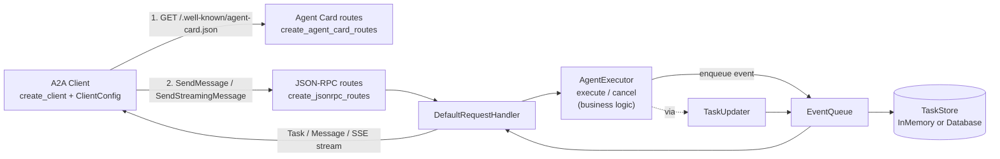
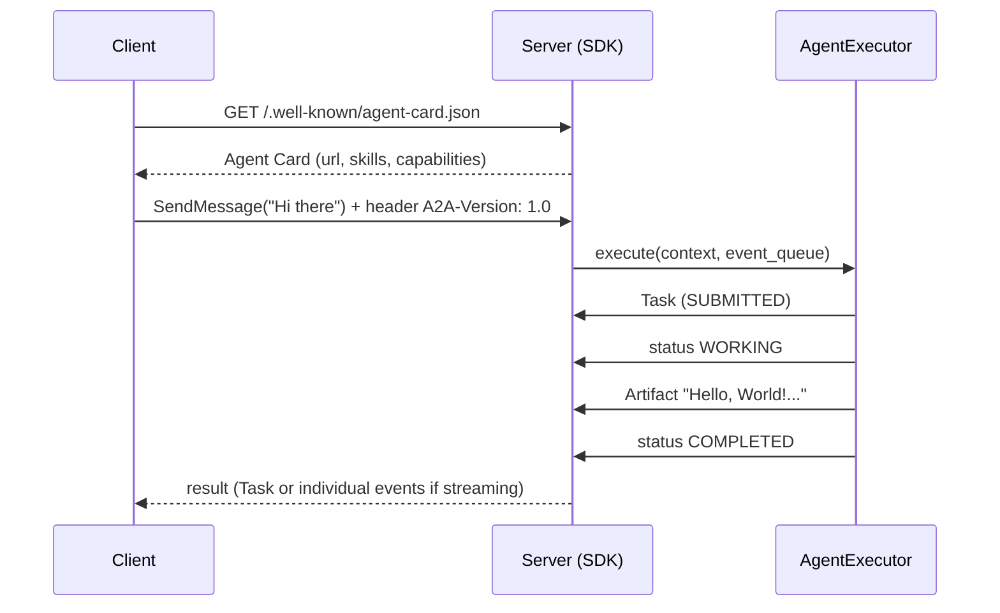
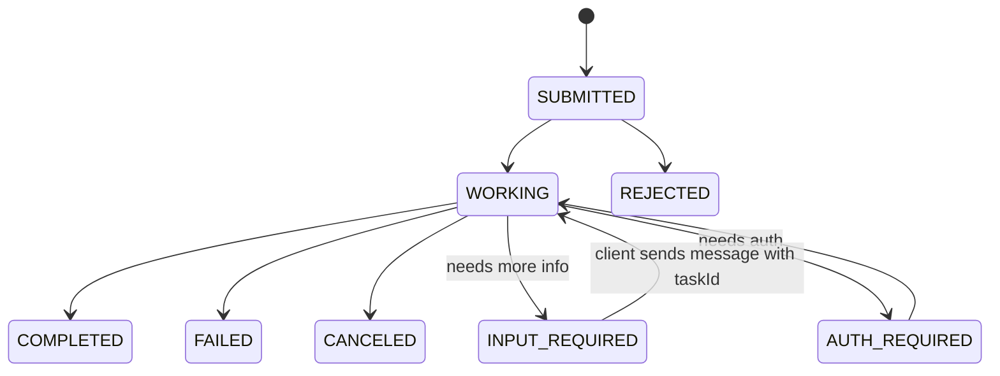

Hello tech enthusiasts! Amid the explosive growth of AI Agents, the **A2A (Agent2Agent)** protocol — an open standard initiated by Google in 2025 and now at a stable **v1.0.0** release — has emerged as a common "diplomatic language" for the multi-agent world. With A2A, AI Agents built in any language or framework can easily discover each other, delegate tasks, and collaborate across networks in a standardized way.

---

## 1. What is A2A for? Connecting Isolated Agent "Islands"

Imagine you have a **"Travel Assistant"** agent that needs a **"Hotel Booking"** agent to handle accommodations. The catch is that the other agent runs on a different server, built by a different team using a completely different framework. Neither side can call functions directly in the other's codebase, nor should they peek into each other's internal prompts, memory, or tools. **A2A (Agent2Agent)** is the **shared convention** that allows two independent agents like these to identify each other, hand off work, track progress, and accept deliverables.

Consider the analogy of a **smart auto repair shop**:
1. **Customer talks to the Shop Manager**: The customer's agent has a multi-turn conversation with the "Shop Manager" agent to describe symptoms and diagnose car issues. This is **A2A** — an agent conversing with another agent.
2. **Mechanic orders parts from a Supplier**: The "Mechanic" agent checks inventory and places an order with a "Parts Supplier" agent at another company. This is also cross-organization **A2A** interaction.
3. **Mechanic plugs in a diagnostic scanner**: The "Mechanic" agent calls `scan_vehicle_for_error_codes(...)`. Here, the agent is using its own tool — that falls under **MCP (Model Context Protocol)**, not A2A.

From this story, **4 core principles** define A2A:
- **A2A connects Agent to Agent; MCP connects Agent to Tool**: The two protocols complement rather than replace each other.
- **"Opaque Agent" Philosophy**: The delegator only sees the **business card** (*Agent Card*) and the **work ticket** (*Task*), never the internal prompts or tools of the worker.
- **Flexible Delegation**: Every request starts with `SendMessage`; the receiver responds with either a **Message** (for short, immediate replies) or a **Task** (for long-running work requiring progress tracking).
- **Separation of Infrastructure and Business Logic**: Developers only write reasoning logic inside `AgentExecutor`; HTTP, JSON-RPC, SSE event streaming, and Task persistence are all handled by the SDK layer.

---

## 2. High-Level Architecture: Core Building Blocks of A2A

When designing a system, an A2A communication network is composed of participating roles, circulating data entities, and an internal Server event-processing pipeline.

### 2.1 Four Actors and Five Data Entities

Every A2A session involves **4 actors** working together:

| Actor | Architectural Role | Example |
|---|---|---|
| **User** | The end user or service setting the initial goal | Customer |
| **A2A Client** | The app or Agent calling another Agent on the User's behalf | "Travel Assistant" Agent |
| **A2A Server (Remote Agent)** | An Agent exposing an A2A-compliant HTTP endpoint, acting as a "black box" | "Hotel Booking" Agent |
| **Agent Card** | A JSON profile describing the Server: name, URL, skills, and auth methods | Digital business card |

As Client and Server converse, they exchange **5 standard data entities**:

| Data Entity | Conceptual Meaning | Role in Communication |
|---|---|---|
| **Message** | A single turn of speech (from `user` or `agent`) | Conversing, clarifying, reporting status |
| **Part** | The smallest content unit inside `Message` / `Artifact`: text, file (URL/bytes), or structured data | Packaging multimodal content |
| **Task** | A work ticket with an ID and status lifecycle | Tracking and managing long-running work |
| **Artifact** | The official deliverable of a `Task` (documents, images, JSON...) | Holds the **actual output** |
| **contextId / taskId** | Conversation ID / Work ticket ID | The thread tying turns together |

### 2.2 Internal Architecture of an A2A Server

To turn an AI Agent into an A2A Server, the system cleanly separates the network transport layer, event orchestration layer, and business execution layer. The diagram below traces a request flowing through a Server's internal components:

*Layered architecture of an A2A Server: Decoupling network protocol handling (Routes, RequestHandler) from Agent intelligence (AgentExecutor) via an EventQueue.*

Each architectural block in the diagram has a clear responsibility:

| Component | Core Responsibility |
|---|---|
| `AgentCard` + `AgentSkill` | Declares the Agent's capability profile and skill list |
| `AgentExecutor` | **Business Logic Core**: The only place containing Agent logic via `execute` and `cancel` |
| `RequestContext` | Bundles request context: `message`, `current_task`, `task_id`, `context_id`, etc. |
| `EventQueue` & `TaskUpdater` | Asynchronous event queue and helper utilities for pushing compliant status/Artifact updates |
| `DefaultRequestHandler` | Orchestrator: Receives requests, invokes the Executor, collects events from the Queue, persists Tasks, and replies to the Client |
| `TaskStore` (`InMemory` / `Database`) | Stores `Task` state in memory or a persistent database |

### 2.3 Full Lifecycle of a Delegation Turn

When these pieces operate together, a standard interaction from discovering the card to receiving the result unfolds across 5 steps in the sequence diagram below:

*Sequence diagram of a standard turn: Create/fetch Task (`SUBMITTED`) → Report progress (`WORKING`) → Execute logic → Attach deliverable (`Artifact`) → Mark done (`COMPLETED`).*

---

## 3. Deep Dive into Core A2A Concepts

With the big picture in mind, let's examine the key design mechanisms that allow A2A to coordinate complex tasks between two Agents.

### 3.1 Agent Card: The Business Card for Self-Discovery

Hosted at the standard path `/.well-known/agent-card.json`, the **Agent Card** lets Clients inspect whether a Server has the required skills and where to reach it. A card includes:
- **Identity & Formats**: `name`, `description`, `version`, and default input/output MIME types (`default_input_modes` / `default_output_modes`, e.g., `text/plain`).
- **Capabilities & Skills**: Declares support for `streaming`, `pushNotifications`, `extended_agent_card`, and the Agent's specialized skills.
- **Supported Interfaces (`supported_interfaces`)**: A key v1.0 change is that `protocol_version='1.0'` now lives **inside each interface** (alongside `protocol_binding` such as JSONRPC, gRPC, or REST, and `url`), rather than at the top level of the Card as in older drafts. Servers can also expose an **Extended Agent Card** (via `GetExtendedAgentCard`) with richer details for authenticated Clients.

### 3.2 Message vs. Task: Quick Reply or Work Ticket?

Upon receiving `SendMessage`, the Server can return either a **Message** or a **Task** depending on complexity:

| Criterion | Reply with **Message** | Reply with **Task** |
|---|---|---|
| **When to use** | Short, self-contained tasks answered immediately without tracking | Long-running, multi-step work needing progress tracking |
| **State management** | Stateless | Strict state lifecycle |
| **Where output lives** | Directly inside `Message` | Packaged inside **Artifact** |
| **Example** | *"What is the capital of France?"* | *"Write a market report"*, *"Book a flight"* |

In practice, there are 3 Agent design patterns: always return `Message`; always return `Task`; or **hybrid** — using `Message` to negotiate scope first, then transitioning to a `Task` once agreed. For multi-step LLM and tool-calling Agents, **Task** is the primary choice because it supports cancellation, progress tracking, and follow-up user input.

### 3.3 Task Lifecycle and State Machine

Every `Task` in A2A follows a well-defined state machine from creation to completion:

*State machine of an A2A Task showing active, interrupted, and terminal branches.*

Three crucial rules stand out from this diagram:
- **Interrupted States (`INPUT_REQUIRED`, `AUTH_REQUIRED`)**: When the Agent needs additional information or authentication, the Task pauses rather than failing. Once the Client sends a follow-up message carrying the matching `taskId`, the Task resumes `WORKING`.
- **Terminal States (`COMPLETED`, `FAILED`, `CANCELED`, `REJECTED`)**: Once a Task reaches a terminal state, it **can never be restarted (no restart)** and its terminal state is set once and for all.
- **Refining Outputs**: To request edits to a completed Task's deliverable, the Client must create a **new Task** within the same conversation (`contextId`) and point `referenceTaskIds` to the previous Task.

### 3.4 The `contextId` / `taskId` Duo and 3 Ways to Receive Results

To sustain multi-turn conversations, A2A uses **`contextId`** and **`taskId`**:
- The first message opens a new `contextId`. Subsequent turns pass the same `contextId` to preserve conversation continuity (a single `contextId` can spawn multiple sequential or parallel `Task`s, such as booking a flight → booking a hotel → booking a spa).
- `taskId` is attached when the Client explicitly specifies: *"This message is the follow-up answer for the specific Task currently paused at `INPUT_REQUIRED`."*

For receiving results, A2A supports **3 flexible mechanisms** across 11 RPC methods (`SendMessage`, `SendStreamingMessage`, `GetTask`, `ListTasks`, `CancelTask`, `SubscribeToTask`, `GetExtendedAgentCard`, plus 4 Push configuration methods):

| Delivery Mechanism | How It Works | Requirements |
|---|---|---|
| **Polling (Request/Response)** | Call `SendMessage`. By default, the Server waits until the Task finishes or pauses; for long jobs, set `returnImmediately=true` and poll `GetTask`. | Supported by all Servers by default |
| **Streaming (SSE)** | Call `SendStreamingMessage` or `SubscribeToTask` to hold a connection and receive status/Artifact events live as they are emitted. | `capabilities.streaming=True` in Card |
| **Push (Webhook)** | The Server proactively calls a Client-registered Webhook URL whenever the Task has major updates. | `capabilities.pushNotifications`; ideal for very long jobs or disconnected Clients |

### 3.5 `AgentExecutor` Execution Rules

On the Server side, `AgentExecutor` does not return results with a `return` statement; instead, it pushes events into `EventQueue` via `TaskUpdater`. At runtime, the system enforces strict safety guarantees:
- **Yielding on Pause**: When emitting `INPUT_REQUIRED` (or inline `AUTH_REQUIRED`), the Executor ends its current run immediately to free resources; when the user replies, the system reloads the existing Task into `context.current_task` and invokes the Executor again.
- **Cancellation, Errors & Timeouts**: On `CancelTask`, the system interrupts the running task and invokes `cancel()` to emit `CANCELED`. If the Executor throws an unexpected exception, the Task automatically transitions to `FAILED`. Tasks stuck waiting for user input too long are cleaned up via `interrupted_task_timeout`.
- **Version Control**: Clients always send the `A2A-Version: 1.0` header. Per the specification, if this header is omitted, the Server treats the request as legacy version `0.3`.

---

## Conclusion

Looking at the full picture of the **A2A Protocol**, it stands out as a foundational standardization piece that moves AI Agents beyond isolated silos into cross-system collaboration. Mastering its 4 pillars — **Capability Profiles (`Agent Card`)**, **Work State Machine (`Task` & `Artifact`)**, **Event-Driven Server Architecture (`AgentExecutor` & `EventQueue`)**, and **the clear division of labor between A2A and MCP** — gives you a rock-solid foundation for designing any modern Multi-Agent network.

How do you see A2A fitting into your upcoming projects? Is your system currently using lightweight in-process Subagents, or is it time to open A2A endpoints so specialized Agents can shake hands across the network? Share your thoughts and let's discuss!
