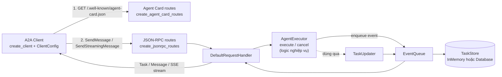
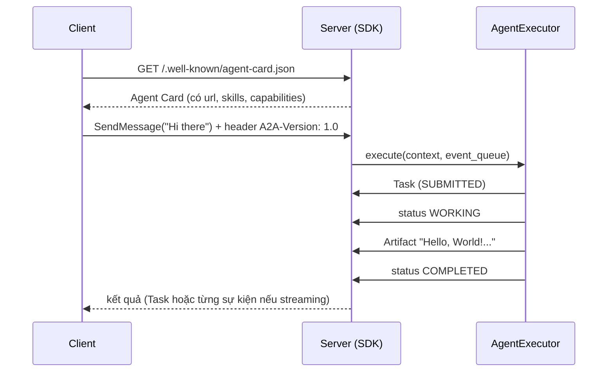
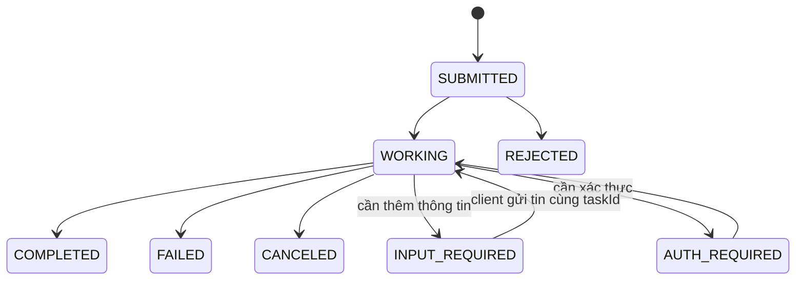

Chào anh em yêu công nghệ! Trong làn sóng AI Agent phát triển bùng nổ, giao thức **A2A (Agent2Agent)** — chuẩn mở do Google khởi xướng vào năm 2025 và hiện đã đạt mốc **v1.0.0** ổn định — đã ra đời như một "ngôn ngữ ngoại giao" chung cho thế giới đa tác tử (Multi-Agent). Với A2A, các AI Agent dù được viết bằng bất kỳ ngôn ngữ hay framework nào cũng có thể dễ dàng tìm thấy nhau, giao việc và phối hợp giải quyết bài toán qua mạng một cách chuẩn hóa.

---

## 1. A2A dùng để làm gì? Bài toán kết nối những "ốc đảo" Agent

Hãy tưởng tượng bạn có một agent **"Trợ lý du lịch"** cần nhờ một agent **"Đặt khách sạn"** xử lý phần lưu trú. Ngặt nỗi, agent kia lại chạy ở máy chủ khác, do đội ngũ khác viết bằng một framework hoàn toàn khác biệt. Hai bên không thể gọi trực tiếp hàm trong code của nhau, và cũng không được phép nhìn thấu prompt, bộ nhớ hay công cụ nội bộ của bên kia. **A2A (Agent2Agent)** chính là **bộ quy ước chung** để hai agent độc lập như vậy nhận diện nhau, bàn giao việc, theo dõi tiến độ và nghiệm thu kết quả.

Hãy hình dung qua câu chuyện của một **tiệm sửa xe thông minh**:
1. **Khách hàng trao đổi với Quản lý tiệm**: Agent của khách trò chuyện nhiều lượt với agent "Quản lý tiệm" để mô tả triệu chứng và chẩn đoán lỗi xe. Đây là việc của **A2A** — agent đối thoại với agent.
2. **Thợ máy đặt linh kiện từ Nhà cung cấp**: Agent "Thợ máy" hỏi tồn kho và đặt hàng từ agent "Nhà cung cấp phụ tùng" ở công ty khác. Đây tiếp tục là một tương tác **A2A** xuyên tổ chức.
3. **Thợ máy cắm máy quét lỗi**: Agent "Thợ máy" gọi hàm công cụ `scan_vehicle_for_error_codes(...)`. Lúc này agent đang dùng công cụ của chính nó — đây là phạm vi của **MCP (Model Context Protocol)** chứ không phải A2A.

Từ câu chuyện trên, có **4 nguyên lý cốt lõi** định hình nên A2A:
- **A2A nối Agent với Agent; MCP nối Agent với Tool**: Hai giao thức bổ sung cho nhau chứ không thay thế nhau.
- **Triết lý "Hộp đen" (Opaque Agent)**: Bên giao việc chỉ thấy **danh thiếp** (*Agent Card*) và **phiếu việc** (*Task*), hoàn toàn không thấy prompt hay tool bên trong phía nhận việc.
- **Giao việc linh hoạt**: Mọi yêu cầu bắt đầu bằng thao tác `SendMessage`; phía nhận trả về một **Message** (cho việc ngắn, tức thời) hoặc một **Task** (cho việc dài, cần theo dõi tiến độ).
- **Tách biệt hạ tầng và nghiệp vụ**: Lập trình viên chỉ cần viết logic suy luận ở tầng `AgentExecutor`; toàn bộ HTTP, JSON-RPC, luồng sự kiện SSE và lưu trữ Task đều do tầng SDK đảm nhiệm.

---

## 2. Kiến trúc tổng quan: Các mảnh ghép chính của A2A

Khi bước vào thiết kế hệ thống, một mạng lưới giao tiếp A2A được cấu thành từ các vai trò tham gia, cấu trúc dữ liệu luân chuyển và luồng xử lý sự kiện bên trong Server.

### 2.1 Bốn vai trò (Actors) và Năm thực thể dữ liệu

Trong mọi phiên làm việc của A2A, luôn có **4 vai trò** phối hợp với nhau:

| Vai trò | Bản chất kiến trúc | Ví dụ |
|---|---|---|
| **User** | Người dùng hoặc dịch vụ đặt ra mục tiêu ban đầu | Khách hàng |
| **A2A Client** | Ứng dụng hoặc Agent đại diện User đi gọi Agent khác | Agent "Trợ lý du lịch" |
| **A2A Server (Remote Agent)** | Agent mở HTTP endpoint theo chuẩn A2A, hoạt động như một "hộp đen" | Agent "Đặt khách sạn" |
| **Agent Card** | Tệp JSON mô tả hồ sơ của Server: tên, địa chỉ, kỹ năng, cách xác thực | Tấm danh thiếp điện tử |

Khi Client và Server trò chuyện, chúng trao đổi thông qua **5 loại dữ liệu** chuẩn:

| Thực thể dữ liệu | Bản chất khái niệm | Vai trò trong luồng giao tiếp |
|---|---|---|
| **Message** | Một lượt phát ngôn (của `user` hoặc của `agent`) | Trao đổi, hỏi lại, thông báo trạng thái |
| **Part** | Mẩu nội dung nhỏ nhất trong `Message` / `Artifact`: văn bản, file (URL/bytes) hoặc dữ liệu cấu trúc | Đóng gói nội dung đa phương thức |
| **Task** | Phiếu công việc có mã số định danh và vòng đời trạng thái | Theo dõi và quản lý các việc dài hơi |
| **Artifact** | Sản phẩm bàn giao chính thức của `Task` (tài liệu, ảnh, JSON...) | Chứa **kết quả đầu ra thực sự** |
| **contextId / taskId** | Mã cuộc hội thoại / Mã phiếu công việc | Sợi dây nối các lượt trao đổi với nhau |

### 2.2 Sơ đồ kiến trúc tổng thể bên trong một A2A Server

Để biến một AI Agent thành A2A Server, hệ thống được chia tách rạch ròi giữa tầng giao tiếp mạng, tầng điều phối sự kiện và tầng thực thi nghiệp vụ. Sơ đồ dưới đây phác họa đường đi của một yêu cầu xuyên qua các thành phần nội bộ của Server:

*Sơ đồ kiến trúc phân tầng của A2A Server: Tách biệt tầng giao thức mạng (Routes, RequestHandler) với tầng trí tuệ của Agent (AgentExecutor) qua hàng đợi sự kiện (EventQueue).*

Vai trò của từng khối kiến trúc trong sơ đồ trên rất rõ ràng:

| Thành phần | Trách nhiệm cốt lõi |
|---|---|
| `AgentCard` + `AgentSkill` | Khai báo hồ sơ năng lực và danh sách kỹ năng của Agent |
| `AgentExecutor` | **Trái tim nghiệp vụ**: Nơi duy nhất chứa logic của Agent với hai nhánh `execute` và `cancel` |
| `RequestContext` | Gói thông tin của request: `message`, `current_task`, `task_id`, `context_id`... |
| `EventQueue` & `TaskUpdater` | Hàng đợi sự kiện bất đồng bộ và bộ hàm tiện ích giúp Executor đẩy cập nhật trạng thái/Artifact đúng chuẩn |
| `DefaultRequestHandler` | Nhạc trưởng điều phối: Nhận request, gọi Executor, gom sự kiện từ Queue, lưu Task và trả lời Client |
| `TaskStore` (`InMemory` / `Database`) | Nơi lưu trữ trạng thái của các `Task` trên RAM hoặc trong cơ sở dữ liệu bền vững |

### 2.3 Vòng tuần hoàn của một lượt giao việc hoàn chỉnh

Khi các mảnh ghép trên vận hành cùng nhau, một phiên giao tiếp chuẩn từ lúc lấy danh thiếp cho tới khi nhận kết quả sẽ diễn ra qua 5 nhịp trên biểu đồ tuần tự dưới đây:

*Biểu đồ tuần tự một lượt chạy chuẩn: Lấy hoặc tạo Task (`SUBMITTED`) → Báo đang xử lý (`WORKING`) → Thực thi logic → Đính kèm sản phẩm (`Artifact`) → Báo hoàn tất (`COMPLETED`).*

---

## 3. Giải phẫu các khái niệm cốt lõi trong A2A

Nắm được bức tranh tổng thể rồi, chúng ta hãy đi vào những cơ chế thiết kế đắt giá nhất giúp A2A điều phối các tác vụ phức tạp giữa hai Agent.

### 3.1 Agent Card: Tấm danh thiếp cho khả năng tự khám phá (Discovery)

Đặt tại đường dẫn chuẩn `/.well-known/agent-card.json`, **Agent Card** giúp Client đọc trước để biết Server có kỹ năng mình cần hay không và gọi vào địa chỉ nào. Một tấm danh thiếp gồm:
- **Định danh & Định dạng**: `name`, `description`, `version`, cùng các kiểu MIME đầu vào/đầu ra mặc định (`default_input_modes` / `default_output_modes`, ví dụ `text/plain`).
- **Năng lực (`capabilities`) & Kỹ năng (`skills`)**: Khai báo hỗ trợ `streaming`, `pushNotifications`, `extended_agent_card` và danh sách kỹ năng chuyên môn của Agent.
- **Giao diện kết nối (`supported_interfaces`)**: Điểm mới quan trọng ở chuẩn v1.0 là thông tin phiên bản giao thức (`protocol_version='1.0'`) nằm **bên trong từng interface** (kèm `protocol_binding` như JSONRPC, gRPC, REST và `url`), thay vì nằm ở cấp ngoài cùng của Card như bản cũ. Ngoài ra, Server có thể cung cấp thêm **Card mở rộng** (qua `GetExtendedAgentCard`) chứa thông tin chi tiết hơn cho các Client đã xác thực.

### 3.2 Message hay Task: Khi nào trả lời nhanh, khi nào lập phiếu việc?

Khi nhận lệnh `SendMessage`, Server có thể chọn trả về một **Message** hoặc một **Task** tùy theo độ phức tạp:

| Tiêu chí | Phản hồi bằng **Message** | Phản hồi bằng **Task** |
|---|---|---|
| **Khi nào dùng** | Việc ngắn gọn, trả lời trọn vẹn ngay, không cần theo dõi | Việc dài hơi, nhiều bước, cần theo dõi tiến độ |
| **Quản lý trạng thái** | Không có trạng thái | Có vòng đời trạng thái chặt chẽ |
| **Nơi chứa kết quả** | Nằm ngay trong `Message` | Đóng gói trong **Artifact** |
| **Ví dụ** | *"Thủ đô của Pháp là gì?"* | *"Viết báo cáo thị trường"*, *"Đặt chuyến bay"* |

Thực tế có 3 kiểu thiết kế Agent: chỉ trả `Message`; luôn trả `Task`; hoặc **lai (hybrid)** — dùng `Message` để thương lượng phạm vi công việc trước, chốt xong mới chuyển sang `Task`. Với các Agent gọi LLM và công cụ nhiều bước, **Task** là lựa chọn chủ đạo vì cho phép hủy ngang, theo dõi tiến độ hoặc hỏi lại người dùng.

### 3.3 Vòng đời của Task và Máy trạng thái (State Machine)

Mọi `Task` trong A2A đều vận hành theo một máy trạng thái rõ ràng từ lúc khởi tạo cho tới khi khép lại:

*Máy trạng thái của một Task trong A2A với các nhánh chạy, tạm dừng và kết thúc.*

Nhìn vào sơ đồ trên, ta cần lưu ý 3 quy tắc sống còn:
- **Nhóm trạng thái tạm dừng — Interrupted (`INPUT_REQUIRED`, `AUTH_REQUIRED`)**: Khi Agent cần hỏi thêm thông tin hoặc yêu cầu xác thực, Task không bị hủy mà tạm dừng để chờ phản hồi. Khi Client gửi tin nhắn tiếp theo kèm đúng `taskId`, Task sẽ quay lại trạng thái `WORKING` để chạy tiếp.
- **Nhóm trạng thái kết thúc — Terminal (`COMPLETED`, `FAILED`, `CANCELED`, `REJECTED`)**: Một khi Task đã chạm trạng thái kết thúc thì **không bao giờ khởi động lại (no restart)** và chỉ được chốt trạng thái kết thúc đúng một lần duy nhất.
- **Tinh chỉnh kết quả**: Nếu muốn yêu cầu sửa tiếp sản phẩm của một Task đã hoàn tất, Client phải tạo một **Task mới** trong cùng phiên hội thoại (`contextId`) và dùng `referenceTaskIds` trỏ về Task cũ.

### 3.4 Bộ đôi `contextId` / `taskId` và 3 cách nhận kết quả

Để nối dài cuộc trò chuyện qua nhiều lượt, A2A sử dụng bộ đôi **`contextId`** và **`taskId`**:
- Tin nhắn đầu tiên mở ra một `contextId` mới. Các lượt sau gửi kèm cùng `contextId` này để giữ chung mạch hội thoại (trong một `contextId` có thể sinh ra nhiều `Task` nối tiếp hoặc song song nhau, như đặt vé máy bay → đặt khách sạn → đặt spa).
- `taskId` được đính kèm khi Client muốn chỉ định rõ: *"Tin nhắn này là câu trả lời bổ sung cho đúng cái Task đang tạm dừng ở `INPUT_REQUIRED`"*.

Về phía nhận kết quả, A2A hỗ trợ **3 cơ chế linh hoạt** cùng hệ thống 11 phương thức RPC (`SendMessage`, `SendStreamingMessage`, `GetTask`, `ListTasks`, `CancelTask`, `SubscribeToTask`, `GetExtendedAgentCard` và 4 phương thức cấu hình Push):

| Cơ chế nhận kết quả | Cách hoạt động | Điều kiện áp dụng |
|---|---|---|
| **Polling (Request/Response)** | Gọi `SendMessage`. Mặc định Server chờ tới khi Task xong hoặc tạm dừng mới trả về; với việc dài, bật `returnImmediately=true` rồi gọi `GetTask` định kỳ. | Mặc định trên mọi Server |
| **Streaming (SSE)** | Gọi `SendStreamingMessage` hoặc `SubscribeToTask` để giữ kết nối và nhận trực tiếp từng sự kiện trạng thái/Artifact ngay khi sinh ra. | `capabilities.streaming=True` trong Card |
| **Push (Webhook)** | Server chủ động gọi vào URL Webhook mà Client đã đăng ký mỗi khi Task có thay đổi quan trọng. | `capabilities.pushNotifications`; hợp cho việc rất dài hoặc Client ngắt kết nối |

### 3.5 Nguyên tắc vận hành của `AgentExecutor`

Ở phía Server, `AgentExecutor` không trả kết quả bằng lệnh `return` mà đẩy các sự kiện vào hàng đợi `EventQueue` thông qua `TaskUpdater`. Khi vận hành, hệ thống tuân thủ các chốt chặn an toàn rất chặt chẽ:
- **Nhường điều khiển khi tạm dừng**: Khi phát sự kiện `INPUT_REQUIRED` (hoặc `AUTH_REQUIRED` nội tuyến), Executor kết thúc lượt chạy ngay để giải phóng tài nguyên; khi người dùng trả lời, hệ thống nạp sẵn Task cũ vào `context.current_task` và gọi lại Executor.
- **Hủy, Lỗi & Timeout**: Khi hủy việc (`CancelTask`), hệ thống ngắt tác vụ đang chạy và gọi nhánh `cancel()` để phát trạng thái `CANCELED`. Nếu Executor văng lỗi bất ngờ, Task tự động chuyển sang `FAILED`. Các Task treo quá lâu ở trạng thái chờ người dùng sẽ được giải phóng nhờ cấu hình `interrupted_task_timeout`.
- **Kiểm soát phiên bản**: Client luôn gửi header `A2A-Version: 1.0`. Theo đặc tả, nếu thiếu header này, Server sẽ mặc định coi request đó thuộc phiên bản cũ `0.3`.

---

## Lời kết

Nhìn lại toàn bộ kiến trúc của **A2A Protocol**, có thể thấy đây là mảnh ghép tiêu chuẩn hóa quan trọng bậc nhất để đưa các AI Agent thoát khỏi cảnh hoạt động đơn lẻ và bước vào kỷ nguyên cộng tác xuyên biên giới hệ thống. Chỉ cần nắm vững 4 trụ cột: **Hồ sơ năng lực (`Agent Card`)**, **Máy trạng thái công việc (`Task` & `Artifact`)**, **Kiến trúc Server hướng sự kiện (`AgentExecutor` & `EventQueue`)**, và **Sự phân vai rõ ràng giữa A2A với MCP**, bạn đã có một nền tảng vững chắc để thiết kế bất kỳ mạng lưới Multi-Agent hiện đại nào.

Anh em đánh giá thế nào về tiềm năng của chuẩn A2A trong các dự án sắp tới? Liệu hệ thống của anh em đang cần những Subagent gọn nhẹ chạy cùng tiến trình hay đã đến lúc mở cổng A2A để các Agent chuyên biệt bắt tay nhau qua mạng? Hãy cùng chia sẻ và thảo luận nhé!
