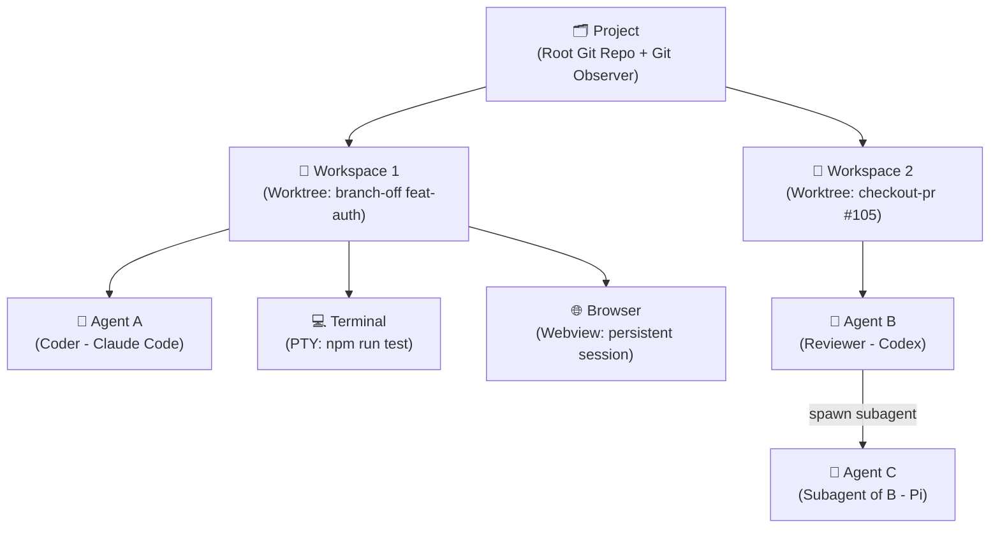
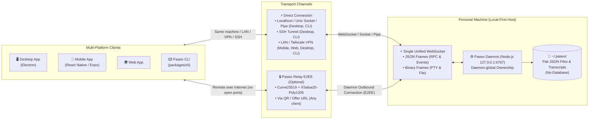
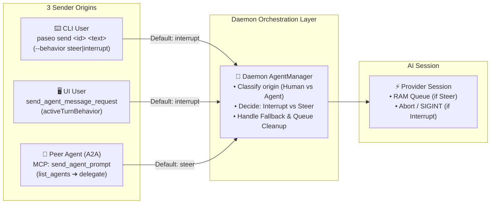
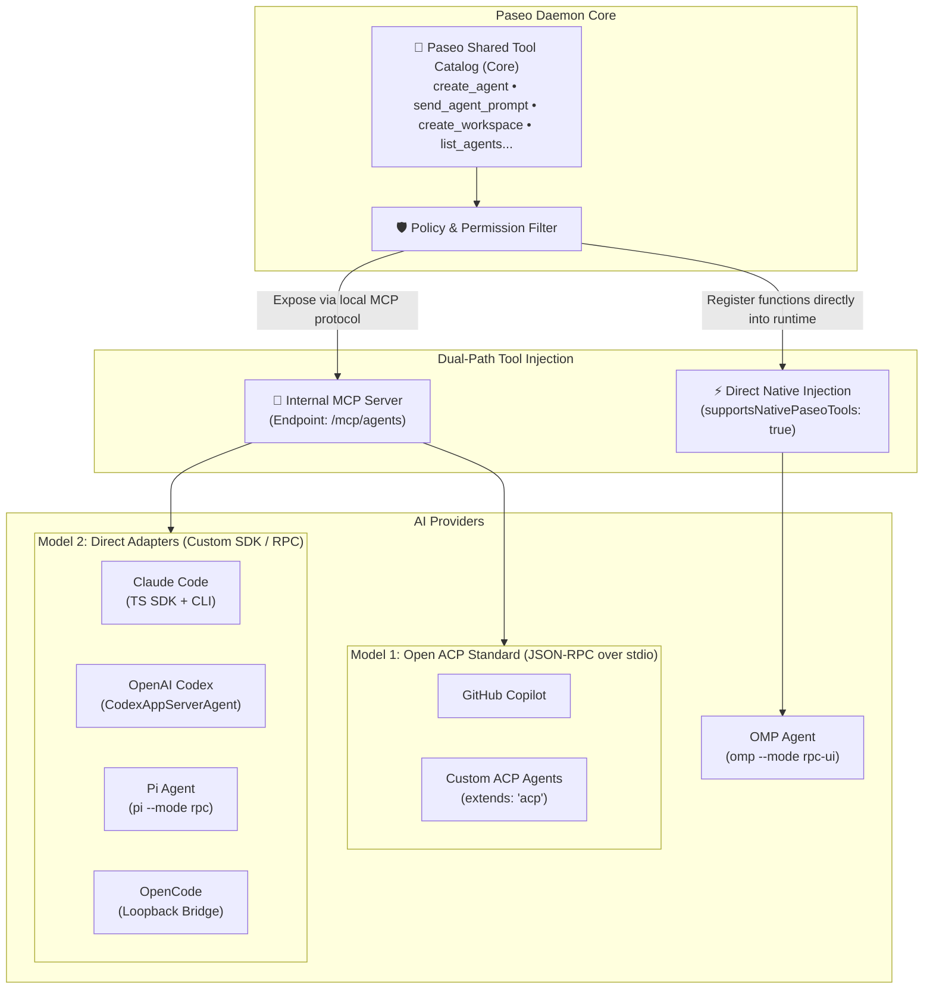

Hello tech enthusiasts! If you're used to opening VS Code or JetBrains to type every line of code yourself with a small AI chat window tucked in the corner, today we're going to explore a completely new wave of tooling. Meet **Paseo** — a newly launched open-source platform for the AI Agent era that lets you orchestrate dozens of AI Agents from different providers working in parallel right on your personal machine, while still being able to monitor and command them seamlessly from your phone or web browser anywhere.

---

## 1. The Core Idea: ADE (Agentic Development Environment)

For over a decade, our software development workflow has revolved around **traditional IDEs (Editor-centric)** like VS Code or JetBrains. In that model, the center of the universe is the developer's keyboard: humans write the code directly, and AI — no matter how smart — only plays the role of a sidekick, offering occasional inline completions or answering questions in a side chat panel.

However, as AI Agents have become capable of planning autonomously, editing multiple files, and running tests on their own, the "Code Editor" label has started to feel restrictive. That's why **Paseo** positions itself not as a mere text editor, but as an open-source **Agentic Development Environment (ADE)** built on a **Local-first** philosophy.

Shifting from an IDE to an ADE fundamentally transforms the engineer's role:
- **From Code Typist to Chief Architect & Reviewer**: At the heart of Paseo are **multiple AI Agents running autonomously in parallel**. Instead of babysitting every line written by a single agent, you operate at a higher level: delegating high-level tasks, tracking overall progress, reviewing diffs/Pull Requests, and signing off on the final output.
- **Conflict-Free Multi-Branch Orchestration**: You can unleash dozens of Agents simultaneously on isolated Git branches without worrying about them stepping on each other's changes.
- **Diverse AI Provider Ecosystem**: Without locking you into a single vendor, Paseo brings together leading AI coding brains including **Claude Code, OpenAI Codex, GitHub Copilot, Pi, OMP, OpenCode**, and any agent compliant with the open **ACP** protocol.
- **Cross-Platform Experience & Automation**: From Desktop (macOS, Windows, Linux), Mobile (iOS, Android), and Web to CLI, you stay connected to your agent fleet, backed by recurring task automation via **Schedules** and periodic check-ins via **Heartbeats**.

---

## 2. Data Model & Domain Entities

Understanding the ADE philosophy is great, but a practical question immediately arises: *How do you manage dozens of Agents running terminal commands, editing files, and opening browsers for testing on the same repository without descending into chaos?*

Paseo's answer lies in a strict hierarchical model built around **4 core entities**: `Project`, `Workspace`, `Agent`, and the `Terminal & Browser` duo. The diagram below illustrates how a Git project is partitioned into isolated workspaces for each team of Agents:

*Structure of the 4 core entities in Paseo: branching from a root Project down into isolated Workspaces where Agents, Terminals, and Browsers operate together.*

Looking closer at each link in the diagram reveals how cleanly Paseo solves resource isolation:

1. **Project (Root Repository)**:
   Represents the root directory of a Git repository on your machine. A standout detail is that Paseo's Daemon maintains a lightweight **Git Observer** using a non-recursive watch directly on `.git/HEAD` and `.git/refs`. This captures every commit or branch change instantaneously without burning CPU or choking disk I/O on repositories with tens of thousands of files.

2. **Workspace (Isolated Work Environment)**:
   Each Workspace is a dedicated "room" containing source code, a PTY terminal, and a browser webview. Depending on your needs, you can choose between 2 `isolation` modes:
   - `local`: Uses the current local directory directly (*shared directory*).
   - `worktree`: Automatically creates an isolated **Git Worktree** so Agents can freely tear down and rebuild code without touching your main branch, supporting 3 convenient modes:
     - `branch-off`: Automatically forks a new branch from `baseBranch`.
     - `checkout-branch`: Points directly to an existing local or remote branch.
     - `checkout-pr`: Automatically fetches and checks out a GitHub/GitLab Pull Request locally for review or bug fixing.
   
   Notably, Paseo applies **smart state separation**: if multiple Workspaces point to the same directory, they automatically share **Directory-backed** state (such as actual Git diffs and Git status on disk), while keeping **Workspace-owned** state completely separate (such as draft review comments or expanded folder trees in the UI).

3. **Agent (AI Working Session)**:
   Each Agent is a session of a specific AI Provider with a clear lifecycle: `created` ➔ `running` ➔ `waiting` ➔ `completed` / `failed` / `archived`. Beyond working solo, Paseo supports a **Parent - Subagent** hierarchy: a parent Agent coding in Workspace 1 can invoke a tool to spawn a Subagent in Workspace 2 for auxiliary tasks.

4. **Terminal & Browser (Interactive Execution Tools)**:
   - **Terminal**: Spawns real **PTY** sessions (OS-standard pseudo-terminals), streaming high-speed binary data to fully support ANSI colors, keyboard shortcuts, and interactive TUI apps.
   - **Browser**: Embeds a `<webview>` with a *persistent Electron session profile*, preserving login cookies across tabs and workspaces — invaluable when you or an Agent need to test authenticated web interfaces directly.

---

## 3. Client-Server Architecture & Networking (Daemon-Centric)

Once the entity model is in place, the next challenge is continuity: *What happens if you assign a massive refactoring task to an Agent and close your Desktop app, or head to a coffee shop and pull out your phone to check how far the Agent has gotten?*

To decouple Agents from the UI layer, Paseo is built around a **Daemon-Centric architecture**.

*Paseo's Daemon-Centric architecture: Every client communicates with the background Daemon over a single multi-purpose WebSocket connection, with end-to-end encryption (E2EE) for remote access.*

### 3.1. Background Daemon (`packages/server`)

At the heart of the system is a **Node.js** process running continuously in the background on your personal host (listening on port `6767` by default, storing state in `~/.paseo/` or `.dev/paseo-home`). The Daemon follows two golden principles:
- **Daemon-global Ownership**: All Projects, Workspaces, and Agents are owned directly by the Daemon rather than by any UI window. Even if you close the Desktop app completely, kill the mobile app, or lose Wi-Fi, your Agents and test processes underneath **keep working uninterrupted**.
- **No-Database Architecture**: Instead of bundling heavy SQLite or PostgreSQL setups prone to migration headaches on upgrades, Paseo persists all configuration and Agent state as schema-versioned flat JSON files (`~/.paseo/agents/<agentId>.json`). It's lightweight, transparent, and trivial to back up or inspect directly.

### 3.2. Diverse Clients & Unified Transport

Whether you connect from the **Desktop App** (Electron), **Mobile App** (React Native/Expo), **Web App**, or **CLI** (`packages/cli`), all communication between Client and Daemon converges onto **a single bidirectional WebSocket connection** split into 2 optimized frame streams:
- **JSON Frames (RPC & Events)**: Handle control commands, prompt delivery, agent status updates, and permission prompts.
- **Binary Frames**: Dedicated to high-throughput Terminal PTY streams and binary file transfers, eliminating text encoding/decoding overhead.

In addition, **Timeline Sync** eliminates the nightmare of dropped messages on flaky networks:
- Seamlessly combines **real-time streaming** (displaying response tokens and reasoning steps as they arrive) with **Durable Transcripts + Pagination** (`fetch_agent_timeline_request`).
- When your phone loses signal and reconnects, the Timeline is automatically reconstructed in full — guaranteed not to miss a single message or duplicate a single row.
- The system also automatically closes transitional states (*terminalizes pending rows*) as soon as a turn finishes, eliminating infinite loading spinners for good.

### 3.3. Local-First Security & E2EE Relay

Many developers naturally worry: *"If I can control it from my phone outside my LAN, does my source code get uploaded to someone's cloud?"* With Paseo, the answer is **No**. All source code, API keys, and Agent processes stay **100% on your personal machine**.

When controlling remotely over the Internet, traffic passes through a **Zero-knowledge E2EE Relay Server** using modern public-key cryptography (**Curve25519 + XSalsa20-Poly1305**). The Relay Server acts purely as a blind courier — forwarding sealed packets without ever holding the keys to decrypt their contents.

---

## 4. Technical Feature Pillars

Beyond managing Agent chat sessions, Paseo equips your workspace with 3 technical pillars to automate the full software development lifecycle:

### 4.1. Workspace Scripts & Service Proxy

When working across multiple Git Worktrees simultaneously, running `npm run dev` in 3 different workspaces easily triggers port collisions (e.g., all three fighting over port `3000`). Paseo solves this cleanly by letting you declare background services (dev servers, backend APIs, test runners) inside your repository's `paseo.json`. The system dynamically allocates ports, opens background monitoring terminals, and activates a **Service Proxy** to reverse-proxy these ports cleanly and safely.

### 4.2. Cron Automation

To turn your AI fleet into 24/7 teammates, Paseo provides 2 cron-based scheduling mechanisms with distinct purposes:
- **Schedule (Fresh Agent Creation)**: Automatically spawns a **brand-new Agent** on a cron schedule — ideal for standalone tasks like daily security vulnerability scans, report summaries, or nightly stale-branch cleanups.
- **Heartbeat (Wake-up Pulse)**: Instead of creating a new session, Heartbeat wakes **the existing Agent** already assigned to a task on a cron interval so it can check whether a CI/CD pipeline has finished, see if a PR has new reviews, or continue a long-running mission.

### 4.3. Plugin Infrastructure (`packages/plugin`)

If your team has specialized workflows, `packages/plugin` lets you write local plugins that hook deeply into the system. You can add custom UI panels/tabs, insert action buttons into the composer toolbar, expose custom RPC endpoints, or tap into key **lifecycle hooks** like `agent:create`, `turn:start`, or `tool:filter` to tightly govern Agent behavior.

---

## 5. Command Delivery & Orchestration

When both humans (typing in CLI, clicking in UI) and peer Agents (A2A communication) send instructions to a running Agent, how does the system coordinate them without descending into chaos?

In Paseo, every instruction request is funneled through **3 standardized entry points** into a single coordinator — `AgentManager` inside the Daemon — before being dispatched to the Provider session:

*Convergence of instructions from 3 sender origins into the Daemon AgentManager before dispatching to the Provider Session.*

### 5.1. Three Flexible Interaction Channels

1. **Via CLI**: Developers or automation scripts can quickly run `paseo send <agent-id> "message"`, with full control flags like `--behavior steer|interrupt`, `--no-wait` (fire-and-forget), or `--image` attachments.
2. **Via UI (Desktop / Mobile / Web)**: Sends a WebSocket RPC packet `send_agent_message_request` carrying `activeTurnBehavior: "steer" | "interrupt"`.
3. **Via Agent-to-Agent (A2A)**: An Agent can discover active teammates using `list_agents`, then invoke the MCP tool `send_agent_prompt` (with `agentId`, `prompt`, and `behavior`) to hand off work or ask for a second opinion.

### 5.2. Two Turn-Control Behaviors: `steer` vs `interrupt`

When you message an idle Agent (`waiting`), it starts immediately. But if the Agent is busy thinking or mid-tool-execution (`running`), Paseo offers 2 clear intervention modes:
- **`steer` (Soft Redirection)**: Keeps the current turn alive without breaking it; the new instruction is gently placed into an **in-memory RAM Queue**. As soon as the Agent finishes its current tool call or reasoning step, it reads this instruction on the next step within the same turn (or the next turn) to adjust course.
- **`interrupt` (Emergency Stop)**: Equivalent to pressing `Ctrl + C`. The Daemon sends an abort / `SIGINT` signal to halt the in-flight turn immediately and forces the Agent to execute the new instruction right away.

### 5.3. Smart Defaults & Safety Fallbacks

Paseo's subtlety shines in how it picks the default behavior based on **Sender Origin**:
- **Human-originated commands**: Default to **`interrupt`**. When a human steps in while an Agent is running, the system prioritizes immediate human intervention.
- **Agent-originated commands (identified via the `PASEO_AGENT_ID` environment variable)**: Default to **`steer`**. When a peer Agent sends a message, it politely queues up to respect its colleague's train of thought without snapping an active tool execution in half.

Additionally, the system enforces 2 critical safety nets:
- **Automatic Fallback**: If an AI Provider does not yet support `steer`, or reports `unavailable` at that moment (e.g., executing a special slash command that cannot be steered), the Daemon **automatically falls back to `interrupt-and-replace`** so instructions are never lost into the void.
- **Queue Flushing on Interrupt**: Whenever a turn is aborted via `interrupt`, the Daemon automatically clears all stale `steer` prompts sitting in the Provider's queue. This completely prevents "ghost prompt" bugs where old queued messages unexpectedly trigger an unwanted turn after you hit stop.

---

## 6. AI Provider Integration (Provider Adapters & Tool Injections)

Today's AI coding tools (from Claude Code and Codex to Copilot, Pi, and OpenCode) are written in different languages and speak different protocol "dialects." How does Paseo bring them all under one roof and grant them control over the Paseo system itself?

The secret is a **Provider Adapters** architecture paired with a flexible **Dual-Path Tool Injection** mechanism.

*Multi-provider integration architecture and the two injection paths delivering internal tools from the Paseo Shared Tool Catalog to each Agent type.*

### 6.1. Two Provider Integration Models

To embrace emerging open standards while maintaining deep compatibility with proprietary tools, Paseo splits its Provider layer into 2 models:

1. **ACP Model (Agent Client Protocol — Recommended for new Providers)**:
   - **Applies to**: GitHub Copilot and any Custom ACP Agents (simply declare `extends: "acp"`).
   - **How it works**: Standardized communication via **JSON-RPC over `stdio` pipes** following the open ACP specification. Paseo's `ACPAgentClient` base class handles all the heavy lifting: spawning child processes, managing session lifecycles, streaming real-time events, and enforcing permission controls.

2. **Direct Adapter Model (Custom `AgentClient` & `AgentSession` implementations)**:
   For major tools with specialized SDKs and optimizations, Paseo implements tailor-made adapters:
   - **Claude Code**: Combines the **Claude Agent TypeScript SDK** with the child CLI process to unlock Claude's full capabilities.
   - **OpenAI Codex**: Communicates via `CodexAppServerAgent`, directly managing `turn/steer` redirection, isolated sandboxes, and network proxies.
   - **OpenCode**: The Daemon launches an internal OpenCode Server, injects daemon plugin config via `OPENCODE_CONFIG_CONTENT`, and talks at high speed over an in-memory **Private Loopback Bridge**.
   - **Pi & OMP**: The Daemon spawns child processes over stdio (`pi --mode rpc`, `omp --mode rpc-ui`), exchanges JSON-RPC messages, and maps their UI extension dialogs onto Paseo's unified permission system.

### 6.2. Paseo Tools Injection

When an Agent needs to spin up a new Workspace or call a peer Agent, it uses Paseo tools like `create_agent`, `send_agent_prompt`, and `create_workspace`. Interestingly, internally these tools **are not hardcoded as pure MCP tools** — they are defined centrally in the Daemon's **Shared Tool Catalog**. From this catalog, the Daemon injects tools in 2 ways depending on the Provider's capabilities:
- **Native Tools Injection**: For providers that support runtime tool registration (`supportsNativePaseoTools: true` such as **OMP**), the Daemon applies policy filters and registers the executable functions directly into the Agent's runtime with zero network middleman.
- **MCP Injection**: For Agents built around the Model Context Protocol (such as **Claude Code, Pi, GitHub Copilot, Codex**), the Daemon automatically spins up a local MCP Server endpoint at `/mcp/agents` and configures the Agent to connect to it at launch.

---

## Conclusion

Looking at the architecture from top to bottom, **Paseo** is clearly more than a wrapper UI around AI CLI tools. It paints a concrete picture of a true **Agentic Development Environment (ADE)**:
- **Frees up your workspace** with the `Project` ➔ `Workspace (Git Worktree)` ➔ `Agent` model, letting dozens of AI Agents grind away on a single repository cleanly and without conflicts.
- **Guarantees persistence and privacy** through a **Daemon-Centric Local-first** design with no complex database dependencies, backed by a unified WebSocket and **E2EE** remote control.
- **Masters multi-agent orchestration** via smart `steer` / `interrupt` routing and extensible integration over both **ACP** and **MCP**.

If you're starting to build workflows with multiple AI Agents working side-by-side — one coding features with Claude Code, another reviewing PRs with Codex, and another running scheduled background tests with Pi — Paseo's system design is well worth exploring and learning from.

What do you think about the shift from traditional IDEs to ADEs? How are you currently coordinating multiple AI Agents in your projects? Let's discuss in the comments!
