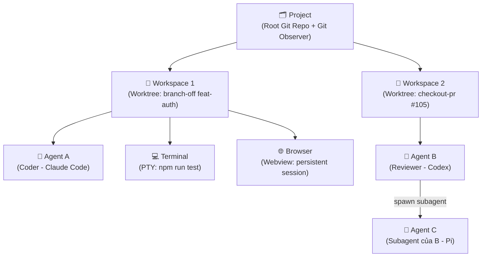
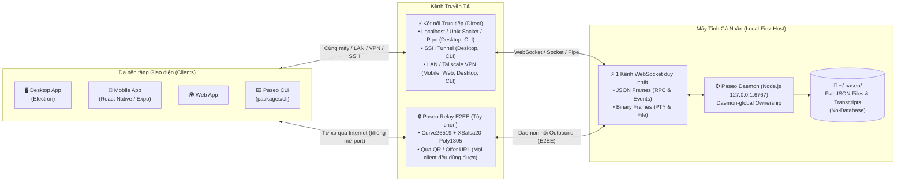
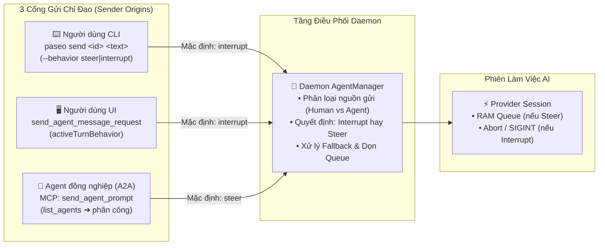
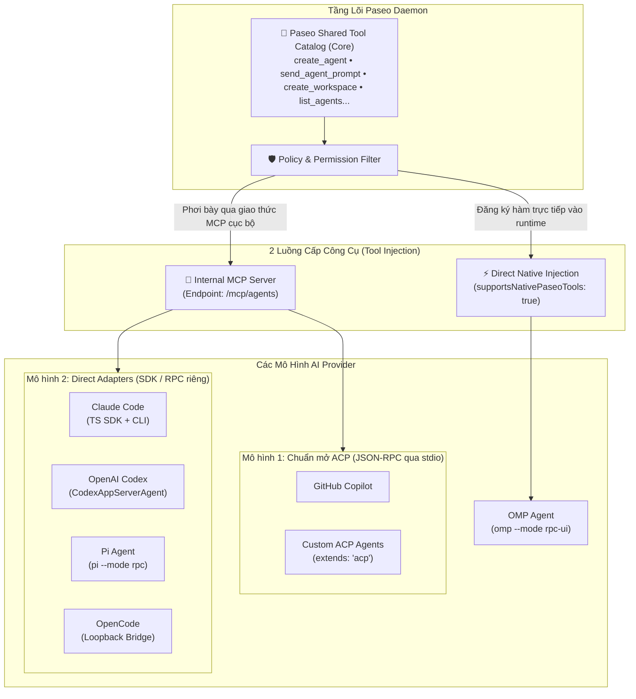

Chào anh em yêu công nghệ! Nếu bạn đã quen với việc mở VS Code hay JetBrains để tự tay gõ từng dòng code với một khung chat AI nhỏ bên góc màn hình, thì hôm nay chúng ta sẽ cùng khám phá một làn sóng công cụ hoàn toàn mới. Đó là **Paseo** — một nền tảng mã nguồn mở vừa ra mắt cộng đồng phát triển phần mềm trong kỷ nguyên AI Agent, mang đến khả năng điều phối hàng chục AI Agent từ nhiều nhà cung cấp khác nhau cùng làm việc song song ngay trên chính máy tính cá nhân của bạn, nhưng vẫn có thể giám sát và chỉ huy mượt mà từ điện thoại hay trình duyệt web ở bất cứ đâu.

---

## 1. Bản Chất: ADE (Agentic Development Environment)

Trong suốt hơn một thập kỷ qua, quy trình làm phần mềm của chúng ta luôn xoay quanh các **IDE truyền thống (Editor-centric)** như VS Code hay bộ công cụ JetBrains. Ở mô hình đó, trung tâm của vũ trụ là bàn phím của lập trình viên: con người trực tiếp gõ code, còn AI dù thông minh đến mấy cũng chỉ đóng vai trò trợ lý phụ tá — lúc thì gợi ý vài dòng lệnh (*inline completion*), lúc thì trả lời câu hỏi ở thanh chat bên hông (*side chat*).

Nhưng khi các AI Agent ngày càng đủ khả năng tự lập kế hoạch, tự sửa nhiều file và tự chạy kiểm thử, chiếc áo "Code Editor" bắt đầu trở nên chật chội. Đó là lý do **Paseo** định vị mình không phải là một trình soạn thảo văn bản đơn thuần, mà là một **Môi trường Phát triển Agentic (ADE — Agentic Development Environment)** mã nguồn mở hoạt động theo triết lý **Local-first**.

Sự chuyển dịch từ IDE sang ADE thay đổi hoàn toàn vị thế của người kỹ sư:
- **Từ người thợ gõ code sang Tổng công trình sư (Architect & Reviewer)**: Trung tâm của Paseo là **nhiều AI Agents chạy tự chủ và song song**. Thay vì ngồi canh từng dòng lệnh của một agent duy nhất, bạn đứng ở tầng cao hơn: giao việc cấp cao, theo dõi tiến độ tổng thể, duyệt các bản diff/Pull Request và nghiệm thu sản phẩm cuối cùng.
- **Điều phối đa nhánh không xung đột**: Bạn có thể thả hàng chục Agent làm việc đồng thời trên các nhánh Git độc lập mà không sợ chúng giẫm chân lên mã nguồn của nhau.
- **Đa dạng hệ sinh thái AI Provider**: Không khóa chặt vào một hãng nào, Paseo quy tụ những bộ não AI coding hàng đầu hiện nay gồm **Claude Code, OpenAI Codex, GitHub Copilot, Pi, OMP, OpenCode** và bất kỳ agent nào tuân theo chuẩn mở **ACP**.
- **Trải nghiệm xuyên suốt & tự động hóa**: Từ Desktop (macOS, Windows, Linux), Mobile (iOS, Android), Web cho đến CLI, bạn luôn kết nối được với đội ngũ agent của mình, kết hợp cùng hệ thống tự động hóa tác vụ định kỳ qua lịch trình (**Schedules**) và nhịp tim kiểm tra (**Heartbeats**).

---

## 2. Mô Hình Dữ Liệu & Các Thực Thể Cơ Bản (Domain Entities)

Hiểu được triết lý ADE là vậy, nhưng câu hỏi thực tế đặt ra là: *Làm sao để quản lý hàng loạt Agent cùng chạy lệnh terminal, cùng sửa file và mở trình duyệt kiểm thử trên một repository mà không tạo ra một mớ hỗn độn?*

Câu trả lời của Paseo nằm ở kiến trúc phân cấp quản lý chặt chẽ theo **4 thực thể cốt lõi**: `Project`, `Workspace`, `Agent`, cùng bộ đôi `Terminal & Browser`. Sơ đồ phân cấp dưới đây phác họa bức tranh toàn cảnh về cách một dự án Git được chia thành các không gian làm việc biệt lập cho từng đội ngũ Agent:

*Sơ đồ cấu trúc 4 thực thể cốt lõi trong Paseo: từ Project gốc phân nhánh xuống các Workspace độc lập, nơi các Agent, Terminal và Browser cùng phối hợp vận hành.*

Đi sâu vào từng mắt xích trong sơ đồ trên, ta sẽ thấy cách Paseo giải quyết bài toán cách ly tài nguyên tinh tế đến mức nào:

1. **Project (Dự án gốc)**:
   Đại diện cho thư mục gốc của một Git repository trên máy bạn. Điểm đắt giá ở đây là Daemon của Paseo duy trì một **Git Observer** siêu nhẹ — chỉ đặt cơ chế theo dõi không đệ quy (*non-recursive watch*) trực tiếp trên `.git/HEAD` và `.git/refs`. Nhờ đó, hệ thống bắt được mọi biến động về commit hay branch tức thì mà không làm hao tổn CPU hay gây nghẽn ổ cứng khi repo có hàng chục nghìn file.

2. **Workspace (Môi trường làm việc biệt lập)**:
   Mỗi Workspace là một "căn phòng riêng" chứa mã nguồn, terminal PTY và webview trình duyệt. Tùy theo nhu cầu, bạn có thể chọn 1 trong 2 chế độ cách ly (`isolation`):
   - `local`: Dùng trực tiếp thư mục cục bộ hiện tại (*shared directory*).
   - `worktree`: Tự động khởi tạo một **Git Worktree** biệt lập để các Agent thoải mái đập đi xây lại mà không ảnh hưởng đến nhánh chính, với 3 chế độ tiện lợi:
     - `branch-off`: Tự tách một nhánh mới từ `baseBranch`.
     - `checkout-branch`: Trỏ thẳng vào một nhánh đã tồn tại trên local hoặc remote.
     - `checkout-pr`: Tự động fetch và checkout một Pull Request từ GitHub/GitLab về máy để review hoặc sửa lỗi.
   
   Đặc biệt, Paseo áp dụng cơ chế **phân tách trạng thái thông minh**: Nếu nhiều Workspace cùng trỏ vào chung một thư mục, chúng sẽ tự động chia sẻ trạng thái **Directory-backed** (như Git diff, Git status thực tế dưới đĩa), nhưng lại tách biệt hoàn toàn ở trạng thái **Workspace-owned** (như bản nháp comment review hay các nhánh cây thư mục đang mở trên giao diện UI).

3. **Agent (Phiên làm việc của AI)**:
   Mỗi Agent là một phiên làm việc (*session*) của một AI Provider cụ thể với vòng đời rõ ràng: `created` ➔ `running` ➔ `waiting` ➔ `completed` / `failed` / `archived`. Không chỉ làm việc đơn lẻ, Paseo hỗ trợ mô hình phân cấp **Cha - Con (Parent - Subagent)**: một Agent cha đang code ở Workspace 1 hoàn toàn có thể gọi công cụ để sinh ra (*spawn*) một Subagent sang Workspace 2 làm nhiệm vụ phụ trợ.

4. **Terminal & Browser (Công cụ thực thi trực quan)**:
   - **Terminal**: Khởi chạy các phiên **PTY** thực tế (thiết bị đầu cuối giả lập chuẩn OS), truyền tải luồng dữ liệu nhị phân tốc độ cao để hỗ trợ đầy đủ màu sắc ANSI, phím tắt và các ứng dụng TUI tương tác.
   - **Browser**: Nhúng trực tiếp `<webview>` với *persistent Electron session profile*, giúp duy trì cookie đăng nhập xuyên suốt giữa các tab và các workspace khác nhau — cực kỳ hữu ích khi bạn hay Agent cần test trực tiếp giao diện web đã đăng nhập.

---

## 3. Kiến Trúc Client - Server & Hạ Tầng Mạng (Daemon-Centric)

Khi đã có mô hình thực thể rõ ràng, thử thách tiếp theo là tính liên tục: *Điều gì xảy ra nếu bạn giao cho Agent một tác vụ refactor lớn rồi gập màn hình ứng dụng Desktop lại, hoặc muốn ra quán cà phê mở điện thoại lên kiểm tra xem Agent chạy tới đâu rồi?*

Để giải phóng Agent khỏi sự phụ thuộc vào giao diện hiển thị, Paseo được thiết kế theo kiến trúc **Daemon-Centric (Lấy tiến trình nền làm trung tâm)**.

*Kiến trúc Daemon-Centric của Paseo: Mọi Client giao tiếp với tiến trình Daemon chạy ngầm qua một kết nối WebSocket đa năng duy nhất, hỗ trợ mã hóa đầu cuối E2EE khi truy cập từ xa.*

### 3.1. Daemon nền tảng (`packages/server`)

Trái tim của toàn bộ hệ thống là một tiến trình **Node.js** chạy ngầm liên tục trên máy chủ cá nhân của bạn (mặc định lắng nghe tại cổng `6767`, lưu trữ dữ liệu tại `~/.paseo/` hoặc `.dev/paseo-home`). Thiết kế của Daemon tuân theo 2 nguyên tắc vàng:
- **Daemon-global Ownership (Quyền sở hữu toàn cục tại Daemon)**: Toàn bộ Project, Workspace và Agent đều thuộc quyền quản lý trực tiếp của Daemon chứ không nằm trong cửa sổ giao diện. Nhờ vậy, ngay cả khi bạn đóng hẳn ứng dụng UI Desktop, tắt app trên điện thoại hay rớt mạng Wi-Fi, các Agent và tiến trình kiểm thử bên dưới **vẫn tiếp tục cặm cụi làm việc bình thường**.
- **No-Database Architecture (Kiến trúc không cơ sở dữ liệu)**: Thay vì cài đặt SQLite hay PostgreSQL cồng kềnh dễ gặp lỗi migration khi nâng cấp, Paseo lưu toàn bộ cấu hình và trạng thái Agent dưới dạng các file JSON phẳng có đánh phiên bản schema (`~/.paseo/agents/<agentId>.json`). Vừa nhẹ, vừa minh bạch, lại dễ dàng sao lưu hoặc đọc trực tiếp.

### 3.2. Đa dạng Client & Kênh giao tiếp hợp nhất

Dù bạn mở Paseo từ **Desktop App** (Electron), **Mobile App** (React Native/Expo), **Web App** hay gõ lệnh qua **CLI** (`packages/cli`), mọi giao tiếp giữa Client và Daemon đều hội tụ trên **duy nhất 1 kết nối WebSocket 2 chiều** được chia làm 2 luồng khung tin tối ưu:
- **Khung tin JSON (RPC & Events)**: Đảm nhận việc gửi lệnh điều khiển, truyền nhận prompt, cập nhật trạng thái agent và xử lý phân quyền.
- **Khung tin Binary (Binary Frames)**: Dành riêng cho luồng dữ liệu Terminal PTY tốc độ cao và truyền tải file nhị phân, giúp loại bỏ độ trễ encode/decode văn bản.

Bên cạnh đó, cơ chế **Đồng bộ Timeline (Timeline Sync)** giải quyết triệt để nỗi ám ảnh mất tin nhắn khi mạng chập chờn:
- Kết hợp nhịp nhàng giữa **Streaming thời gian thực** (hiển thị từng token câu trả lời và luồng suy nghĩ ngay khi phát sinh) với **Durable Transcript + Phân trang** (`fetch_agent_timeline_request`).
- Khi điện thoại của bạn mất sóng và kết nối lại (*reconnect*), Timeline sẽ tự động được tái dựng đầy đủ, cam kết không sót một tin nhắn nào và cũng không bao giờ bị nhân đôi dòng.
- Đặc biệt, hệ thống luôn tự động đóng các trạng thái chờ chuyển tiếp (*terminalize pending rows*) ngay khi một lượt chạy (*turn*) kết thúc, chấm dứt hoàn toàn lỗi giao diện bị treo vòng xoay loading vĩnh viễn.

### 3.3. Bảo mật Local-first & Relay E2EE

Nhiều anh em sẽ lo ngại: *"Điều khiển được qua điện thoại từ ngoài mạng LAN thì source code có phải đẩy lên cloud của hãng không?"*. Với Paseo, câu trả lời là **Không**. Toàn bộ mã nguồn, API keys và tiến trình Agent đều nằm **100% trên máy tính cá nhân của bạn**.

Khi bạn điều khiển từ xa qua Internet, kết nối sẽ đi qua một **Relay Server E2EE (Zero-knowledge)** sử dụng bộ thuật toán mật mã khóa công khai hiện đại **Curve25519 + XSalsa20-Poly1305**. Relay Server ở giữa chỉ đóng vai trò người đưa thư mù — chuyển tiếp các gói tin đã bị khóa kín mà hoàn toàn không có chìa khóa giải mã nội dung bên trong.

---

## 4. Các Trụ Cột Tính Năng Kỹ Thuật

Không dừng lại ở việc quản lý khung chat cho Agent, Paseo trang bị cho không gian làm việc 3 trụ cột kỹ thuật giúp tự động hóa trọn vẹn vòng đời phát triển phần mềm:

### 4.1. Workspace Scripts & Service Proxy

Khi làm việc trên nhiều Git Worktree cùng lúc, việc chạy `npm run dev` ở 3 workspace khác nhau rất dễ dẫn đến đụng độ cổng mạng (ví dụ tất cả cùng giành nhau cổng `3000`). Paseo giải quyết gọn gàng bằng cách cho phép bạn định nghĩa các tiến trình hỗ trợ (dev server, API backend, test runner) ngay trong file `paseo.json` của repository. Hệ thống sẽ tự động cấp phát port động, mở terminal giám sát chạy nền và kích hoạt **Service Proxy** để ánh xạ (*reverse proxy*) các cổng này ra ngoài một cách an toàn và ngăn nắp.

### 4.2. Tự động hóa Lịch trình (Cron Automation)

Để biến đội ngũ AI thành những cộng sự trực chiến 24/7, Paseo cung cấp 2 cơ chế lập lịch dựa trên biểu thức Cron nhưng có mục đích sử dụng rất khác nhau:
- **Schedule (Lịch trình tạo mới)**: Tự động khởi tạo một **Agent hoàn toàn mới** theo chu kỳ định sẵn — cực kỳ lý tưởng cho các tác vụ độc lập như quét lỗ hổng bảo mật mỗi sáng, tổng hợp báo cáo hay dọn dẹp các nhánh Git cũ mỗi đêm.
- **Heartbeat (Nhịp tim đánh thức)**: Thay vì tạo mới, Heartbeat sẽ đánh thức **chính Agent hiện tại** đang phụ trách công việc theo chu kỳ cron để nó tự kiểm tra xem pipeline CI/CD đã chạy xong chưa, PR đã có ai review chưa, hoặc tiếp tục hoàn tất một nhiệm vụ dài hơi.

### 4.3. Hạ tầng Mở rộng Plugin (`packages/plugin`)

Nếu quy trình của đội nhóm bạn có những đặc thù riêng, hạ tầng `packages/plugin` cho phép viết các plugin cục bộ để can thiệp sâu vào hệ thống. Bạn có thể gắn thêm custom UI panel/tab trên giao diện, thêm nút chức năng vào thanh công cụ composer, mở các custom RPC endpoints riêng, hoặc móc nối vào các **hook vòng đời** quan trọng như `agent:create`, `turn:start` hay `tool:filter` để kiểm soát chặt chẽ hành vi của Agent.

---

## 5. Cơ Chế Gửi Lệnh & Điều Phối (Orchestration & Communication)

Khi có cả con người (gõ từ CLI, bấm từ UI) lẫn các Agent khác (giao tiếp A2A) cùng gửi chỉ đạo tới một Agent đang chạy, hệ thống sẽ điều phối ra sao để không bị loạn?

Trong Paseo, mọi yêu cầu gửi chỉ đạo đều được quy hoạch để hội tụ về một đầu mối duy nhất là `AgentManager` bên trong Daemon qua **3 cổng chuẩn hóa**, sau đó mới phân phối xuống phiên làm việc của Provider:

*Luồng hội tụ chỉ đạo từ 3 cổng giao tiếp về Daemon AgentManager trước khi điều tiết vào Provider Session.*

### 5.1. Ba cổng tương tác linh hoạt

1. **Qua CLI**: Lập trình viên hoặc script tự động có thể gọi nhanh lệnh `paseo send <agent-id> "nội dung"`, hỗ trợ đầy đủ các cờ điều khiển như `--behavior steer|interrupt`, `--no-wait` (gửi xong thoát ngay không chờ) hay đính kèm ảnh `--image`.
2. **Qua Giao diện UI (Desktop / Mobile / Web)**: Gửi gói tin WebSocket RPC `send_agent_message_request`, bên trong mang theo trường cấu hình `activeTurnBehavior: "steer" | "interrupt"`.
3. **Qua Giao tiếp Agent-to-Agent (A2A)**: Một Agent có thể tự khám phá danh sách các đồng nghiệp đang có mặt trong hệ thống qua công cụ `list_agents`, sau đó gọi công cụ MCP `send_agent_prompt` (chứa `agentId`, `prompt`, `behavior`) để bàn giao việc hoặc hỏi ý kiến nhau.

### 5.2. Hai hành vi điều khiển Turn: `steer` vs `interrupt`

Khi bạn gửi tin nhắn cho một Agent đang rảnh (`waiting`), nó sẽ chạy ngay. Nhưng nếu Agent đó đang bận suy nghĩ hoặc đang chạy dở một công cụ (`running`), Paseo cung cấp 2 chế độ can thiệp rất rõ ràng:
- **`steer` (Điều hướng mềm)**: Giữ nguyên lượt chạy hiện tại của Agent không bị đứt quãng; chỉ đạo mới được đưa nhẹ nhàng vào **hàng đợi bộ nhớ (RAM Queue)**. Ngay khi Agent hoàn tất bước gọi tool hoặc nhịp suy nghĩ hiện tại, nó sẽ đọc ngay chỉ đạo này ở bước kế tiếp trong cùng turn (hoặc turn tiếp theo) để bẻ lái hướng giải quyết.
- **`interrupt` (Ngắt khẩn cấp)**: Tác động mạnh mẽ tương đương tổ hợp phím `Ctrl + C`. Daemon phát tín hiệu hủy (*abort / SIGINT*) để dừng ngay lập tức lượt chạy đang dang dở và ép Agent chuyển sang thực thi chỉ đạo mới ngay tức khắc.

### 5.3. Quy tắc Mặc định Thông minh & Cơ chế Fallback An toàn

Điểm tinh tế của Paseo nằm ở chỗ nó tự động chọn hành vi mặc định dựa trên **nguồn gửi (Sender Origin)**:
- **Lệnh từ Người dùng (Human-originated)**: Mặc định là **`interrupt`**. Khi con người đã gõ lệnh đè vào lúc Agent đang chạy, hệ thống ưu tiên tuyệt đối ý chí can thiệp tức thời của người chỉ huy.
- **Lệnh từ Agent khác (Agent-originated, nhận diện qua biến môi trường `PASEO_AGENT_ID`)**: Mặc định là **`steer`**. Khi một Agent đồng nghiệp gửi tin nhắn sang, nó sẽ lịch sự xếp hàng chờ để tôn trọng chu trình suy nghĩ của bạn mình, không làm gãy mạch thực thi tool đang chạy.

Ngoài ra, hệ thống còn trang bị 2 chốt chặn an toàn quan trọng:
- **Fallback tự động**: Nếu một AI Provider nào đó chưa hỗ trợ tính năng `steer`, hoặc tại thời điểm đó báo trạng thái `unavailable` (chẳng hạn đang thực thi một slash command đặc biệt không thể bẻ lái), Daemon sẽ **tự động fallback về cơ chế `interrupt-and-replace`** để đảm bảo lệnh không bao giờ bị rơi vào hư vô.
- **Xóa sạch Queue khi Interrupt**: Bất cứ khi nào một lượt chạy bị ngắt bằng `interrupt`, Daemon sẽ tự động dọn sạch toàn bộ các prompt `steer` cũ còn tồn đọng trong hàng đợi của Provider. Điều này ngăn chặn triệt để lỗi "hồn ma": các prompt cũ bị kẹt lại bất ngờ tự kích hoạt lại một turn không mong muốn sau khi bạn đã bấm dừng.

---

## 6. Cơ Chế Tích Hợp AI Provider (Provider Adapters & Tool Injections)

Mỗi công cụ AI hiện nay (từ Claude Code, Codex cho tới Copilot, Pi hay OpenCode) đều được viết bằng ngôn ngữ khác nhau và nói những "thứ tiếng" giao thức khác nhau. Làm thế nào Paseo có thể quy tụ tất cả về chung một mái nhà và trao cho chúng quyền năng điều khiển hệ thống Paseo?

Bí quyết nằm ở kiến trúc **Provider Adapters** kết hợp cùng cơ chế **Dual-Path Tool Injection** (Bơm công cụ hai luồng) cực kỳ linh hoạt.

*Sơ đồ kiến trúc tích hợp đa Provider và 2 nhánh cấp phát bộ công cụ nội bộ từ Paseo Shared Tool Catalog xuống từng loại Agent.*

### 6.1. Hai Mô hình Tích hợp Provider

Để vừa đón đầu chuẩn mở tương lai vừa tương thích sâu với các công cụ độc quyền hiện tại, Paseo chia tầng kết nối Provider thành 2 mô hình lớn:

1. **Mô hình ACP (Agent Client Protocol — Khuyên dùng cho các Provider mới)**:
   - **Áp dụng cho**: GitHub Copilot và mọi Custom ACP Agents (chỉ cần khai báo `extends: "acp"`).
   - **Cơ chế hoạt động**: Giao tiếp chuẩn hóa qua **JSON-RPC trên đường ống `stdio`** theo giao thức mở ACP. Lớp cơ sở `ACPAgentClient` của Paseo đã gánh vác toàn bộ phần việc nặng nhọc: từ khởi chạy tiến trình con, quản lý vòng đời session, streaming sự kiện thời gian thực cho đến kiểm soát cấp quyền.

2. **Mô hình Direct Adapter (Tự triển khai `AgentClient` & `AgentSession` chuyên biệt)**:
   Dành cho những "ông lớn" hoặc công cụ có SDK và cơ chế tối ưu riêng biệt, Paseo viết từng bộ chuyển đổi (*adapter*) đo ni đóng giày:
   - **Claude Code**: Kết hợp trực tiếp **Claude Agent TypeScript SDK** cùng tiến trình CLI con để khai thác tối đa khả năng của Claude.
   - **OpenAI Codex**: Giao tiếp thông qua `CodexAppServerAgent`, trực tiếp quản lý cơ chế điều hướng `turn/steer`, môi trường sandbox cách ly và network proxy.
   - **OpenCode**: Daemon tự khởi chạy một OpenCode Server nội bộ, bơm cấu hình plugin của daemon vào qua biến `OPENCODE_CONFIG_CONTENT` và nói chuyện tốc độ cao qua **Private Loopback Bridge** ngay trên RAM.
   - **Pi & OMP**: Daemon khởi tạo tiến trình con qua đường ống stdio (`pi --mode rpc`, `omp --mode rpc-ui`), trao đổi bằng JSON-RPC và tự động ánh xạ các hộp thoại UI extension của chúng sang hệ thống xin quyền chuẩn của Paseo.

### 6.2. Cơ chế Cấp Công cụ (Paseo Tools Injection)

Khi một Agent cần tạo thêm Workspace mới hay gọi một Agent đồng nghiệp, nó phải dùng các công cụ của Paseo như `create_agent`, `send_agent_prompt`, `create_workspace`... Điểm thú vị là ở tầng nội bộ, các công cụ này **không bị đóng cứng là MCP tools thuần túy**, mà được định nghĩa tập trung trong một **Shared Tool Catalog** của Daemon. Từ kho công cụ chung này, Daemon có 2 cách "bơm" vũ khí cho Agent tùy theo năng lực của từng Provider:
- **Native Tools Injection**: Đối với những provider hỗ trợ nạp công cụ trực tiếp ở tầng runtime (`supportsNativePaseoTools: true` như **OMP**), Daemon sẽ lọc theo chính sách quyền hạn (*policy*) rồi đăng ký thẳng các hàm thực thi vào runtime của Agent mà không cần qua bất kỳ lớp mạng trung gian nào.
- **MCP Injection**: Đối với các Agent quen giao tiếp qua chuẩn Model Context Protocol (như **Claude Code, Pi, GitHub Copilot, Codex**), Daemon sẽ tự động bật một endpoint MCP Server cục bộ tại `/mcp/agents` và tự động cấu hình cho Agent kết nối vào đó ngay khi khởi chạy.

---

## Lời kết

Nhìn lại toàn bộ kiến trúc từ trên xuống dưới, có thể thấy **Paseo** không đơn thuần là một giao diện bọc ngoài cho các công cụ AI CLI. Nó định hình rõ nét bức tranh của một **Môi trường Phát triển Agentic (ADE)** thực thụ:
- **Giải phóng không gian làm việc** với mô hình `Project` ➔ `Workspace (Git Worktree)` ➔ `Agent`, giúp hàng chục AI cùng cày cuốc trên một dự án mà vẫn trật tự, sạch sẽ.
- **Đảm bảo tính bền bỉ và riêng tư tuyệt đối** nhờ kiến trúc **Daemon-Centric Local-first**, không phụ thuộc cơ sở dữ liệu phức tạp, kết hợp cùng kết nối WebSocket hợp nhất và mã hóa đầu cuối **E2EE** khi điều khiển từ xa.
- **Làm chủ nghệ thuật điều phối đa tác nhân** thông qua cơ chế phân luồng thông minh `steer` / `interrupt`, kết hợp cùng khả năng tích hợp mở rộng qua cả chuẩn **ACP** lẫn **MCP**.

Nếu anh em đang bắt đầu xây dựng quy trình làm việc với nhiều AI Agent cùng lúc — một anh chuyên viết tính năng bằng Claude Code, một anh chuyên review PR bằng Codex, một anh chạy kiểm thử ngầm định kỳ bằng Pi — thì cách tiếp cận và thiết kế hệ thống của Paseo chắc chắn là một hình mẫu cực kỳ đáng để trải nghiệm và học hỏi.

Anh em nghĩ sao về xu hướng chuyển dịch từ IDE truyền thống sang ADE? Hiện tại anh em đang phối hợp nhiều AI Agent trong dự án của mình theo cách nào? Hãy chia sẻ góc nhìn cùng thảo luận nhé!
